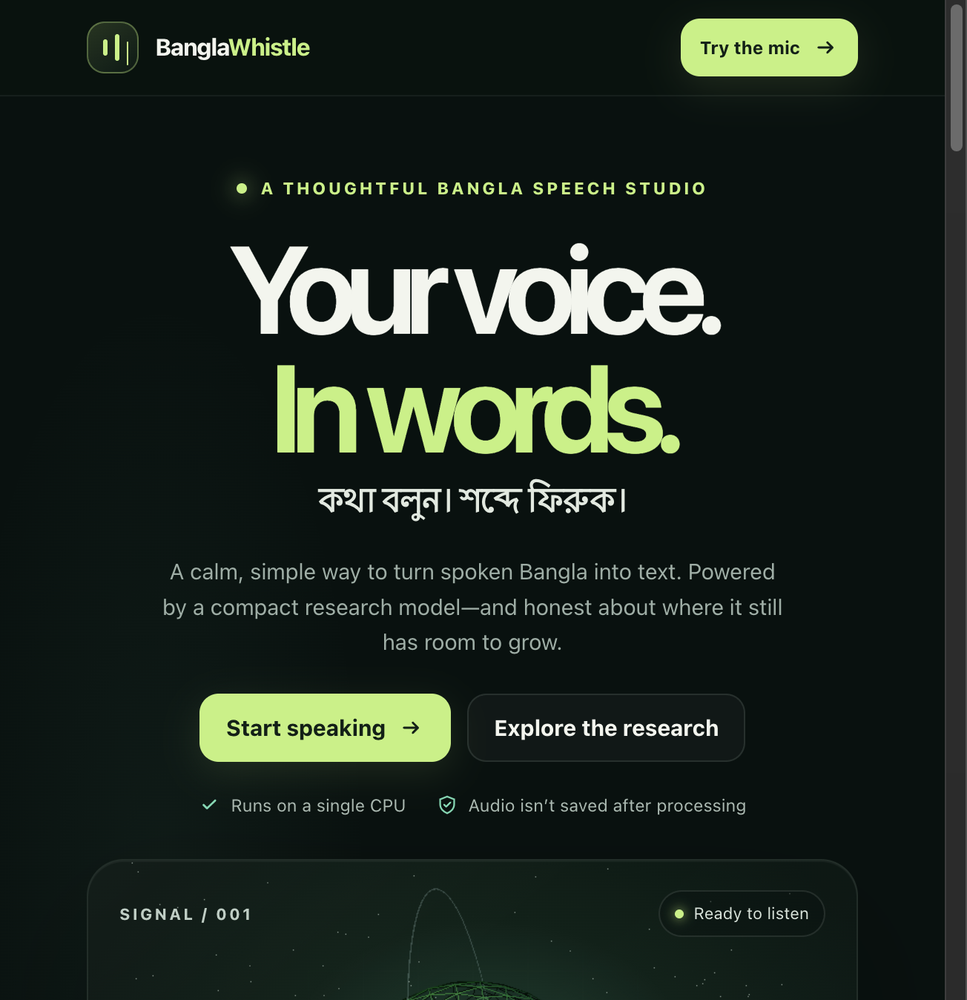
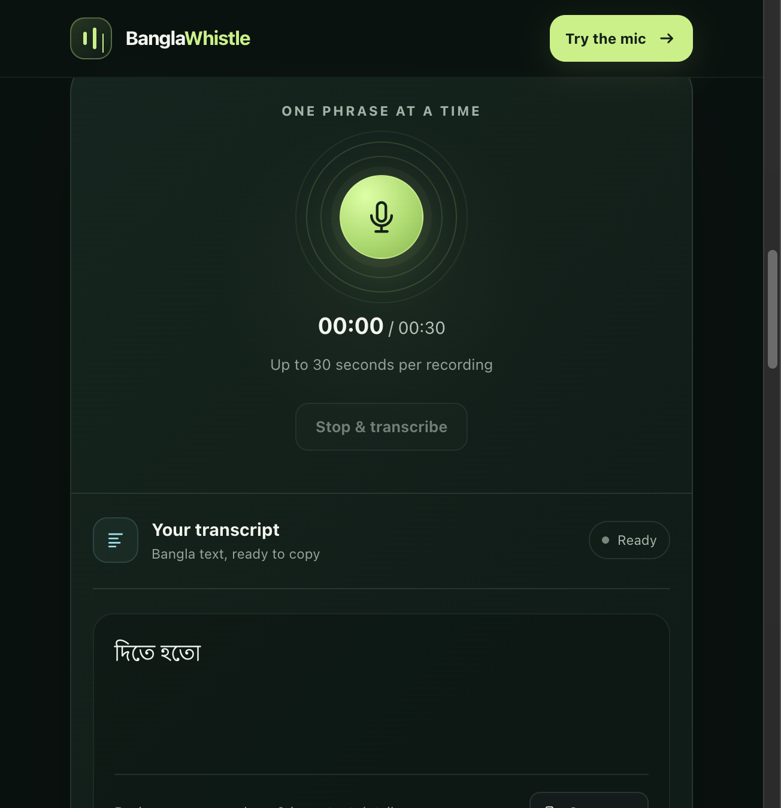
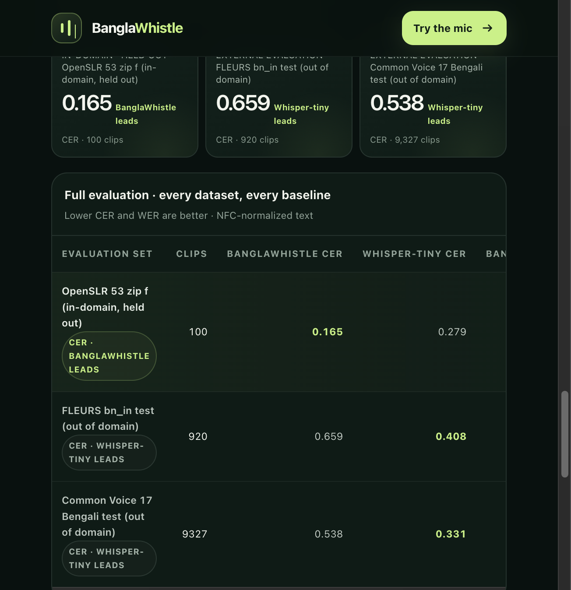

# BanglaWhistle

BanglaWhistle turns spoken Bangla into Bangla text. The model has 16.0 million parameters (15,968,768). The weight file `checkpoints/rslt3/student.pt` is 61 MB (63,944,321 bytes). You give it a short recording. It writes the words.

Lower scores are better. Character error rate (CER) counts wrong characters. Word error rate (WER) counts wrong words.

| Test | Clips | This model CER / WER | whisper-tiny-bn CER / WER |
|:--|--:|--:|--:|
| OpenSLR 53, archive f | 100 | 0.165 / 0.428 | 0.279 / 0.871 |
| FLEURS `bn_in` test | 920 | 0.659 / 0.909 | 0.408 / 0.833 |
| Common Voice 17 Bengali test | 9,327 | 0.538 / 0.939 | 0.331 / 0.862 |

On the 100 OpenSLR clips, this model is better. On FLEURS and Common Voice, the public 37.8 million parameter model [shhossain/whisper-tiny-bn](https://huggingface.co/shhossain/whisper-tiny-bn) is better. Those two tests were not used for training.

The page below is the local website. The transcript is the model reading one short clip as `দিতে হতো`.







## Run it with Docker

Install [Docker Desktop](https://www.docker.com/products/docker-desktop/). Open a terminal in this folder.

```bash
docker build -t bangla-whistle -f site/Dockerfile .
docker run --rm -p 8080:8080 bangla-whistle
```

Open http://127.0.0.1:8080. The first build downloads PyTorch and takes a while. Later builds are faster. The page stays on your computer. Nothing is uploaded.

One file, without the page:

```bash
docker run --rm -v "$PWD:/audio" bangla-whistle transcribe /audio/your.wav
```

## Run it with Python

Install Python 3 and FFmpeg. FFmpeg turns the recording into the format the model expects.

```bash
pip install -r requirements.txt
python3 -m uvicorn app:app --app-dir site --host 127.0.0.1 --port 8080
```

On a Mac, `pip` may be `pip3`. If PyTorch fails to install, use the CPU wheel:

```bash
pip install torch==2.14.1 --index-url https://download.pytorch.org/whl/cpu
pip install -r requirements.txt
```

Then open http://127.0.0.1:8080.

One file, without the page:

```bash
python3 runtime/transcribe.py --model checkpoints/rslt3 --audio your.wav
```

The command prints Bangla text. Recordings longer than 30 seconds are cut at 30 seconds.

To score the 100 clips that ship in `testclips/`:

```bash
python3 runtime/evaluate.py --model checkpoints/rslt3 --clips testclips
```

## Training audio

Training used OpenSLR 53, archives 0 through 7: https://www.openslr.org/53/

Archive `f` is the 100-clip test. It is not for training. The clips in `testclips/` come from that archive. OpenSLR 53 is CC BY-SA 4.0. This repository uses the same license. See `LICENSE`.

The notebook `kaggle/train.ipynb` is the training recipe. It uses a GPU when the machine has one. A GPU finishes sooner. The file `checkpoints/rslt3/student.pt` is the checkpoint that matches the table above. Training again, even on a larger GPU, is a new experiment. It does not make this saved file more accurate. The same `student.pt` prints the same text on a laptop and on a large machine. A faster CPU or GPU only shortens the wait.

## Weights

The same checkpoint is on Hugging Face: https://huggingface.co/mdimamhosen/bangla-whistle

`edge-int8/student.int8.pt` is a smaller copy of the same weights, about 16 MB. On the 100 clips its character error matches the 61 MB file (CER 0.165).

`docs/model-card.md` is the model card. `paper/paper.md` and `paper/paper.pdf` are the write-up. `docs/literature-review.md` lists other Bangla speech papers and which numbers can sit next to 0.165.
